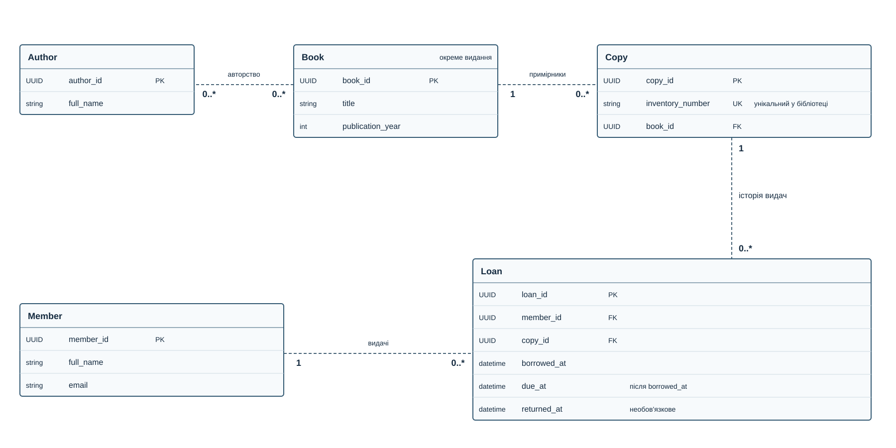

# Лабораторна робота №1 — Домен і модель даних

## Домен: Бібліотека

### Опис предметної області

Бібліотека веде каталог видань та авторів, обліковує фізичні примірники й зберігає історію їхніх видач читачам. Для трьох однакових примірників одного видання створюється один Book і три Copy; кожна видача — окремий Loan.

### Ключові процеси

- Додавання видань та авторів до каталогу.
- Реєстрація примірників за інвентарними номерами.
- Реєстрація читачів.
- Видача, повернення та збереження історії.

Межі: одна бібліотека, паперові книги; без бронювання, штрафів і філій. Робота описує концептуальну модель, а не реалізацію бази даних.

### Структура

- [spec.md](spec.md) — сутності, атрибути, зв'язки та критерії.
- [diagram.mmd](diagram.mmd) — модель у синтаксисі Mermaid.
- [diagram.svg](diagram.svg) — рендер із декларативного опису.
- [DEFENSE.md](DEFENSE.md) — точка входу для перевірки.
- [adr/0001-library-model.md](adr/0001-library-model.md) — ключове рішення за MADR.
- [ai/task.md](ai/task.md), [ai/audit.md](ai/audit.md), [ai/versions/](ai/versions/) — задача, фактичний аудит та версії.
- [ai/prompt-example.md](ai/prompt-example.md) — окремий навчальний діалог.

### ER-діаграма

PK — первинний ключ, FK — посилання, UK — альтернативний унікальний ключ. SVG відтворюється локальним рендерером підтриманого піднабору Mermaid: `python ai/render.py`. Позначення 1 та 0..* біля кінців ліній задають кардинальності; вихідний Mermaid також можна відкрити у сумісному редакторі.
