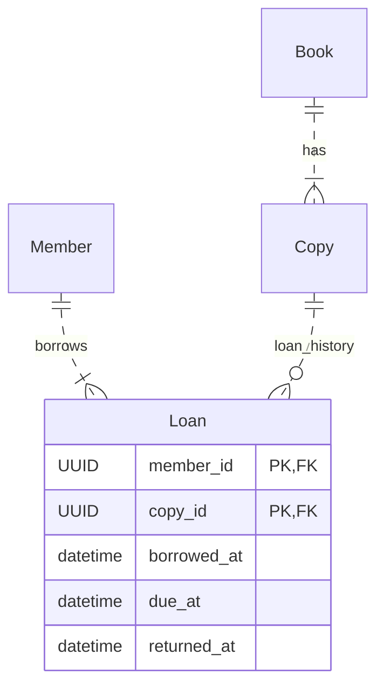
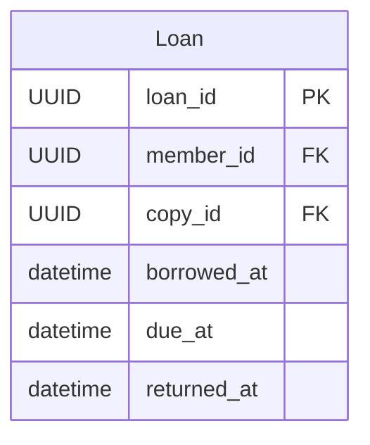

## 1. Вибір домену

**Студент:** Хочу змоделювати бібліотеку. Мені потрібні книги, автори, примірники, читачі та видачі. Чи достатньо цього для ER-моделі?

**Інструмент:** Так. Модель охопить каталог та історію видач. Для невеликої роботи можна виключити штрафи, бронювання й філії.

**Студент:** Чому книгу й примірник потрібно розділяти?

**Інструмент:** Book описує видання, а Copy — фізичну книгу. Два однакові примірники мають спільний опис, але різні інвентарні номери.

## 2. Специфікація

**Студент:** Спочатку сформулюй spec: перелік атрибутів, ключів і зв'язків. Я хочу мати критерії, за якими потім перевірю результат.

**Інструмент:** Основні критерії: однакові типи PK/FK, явні кардинальності, 3NF для атрибутів та збереження історії видач. Чисте авторство M:N залишимо прямим зв'язком.

**Студент:** Чому тоді Loan — окрема сутність, а BookAuthor не потрібна?

**Інструмент:** Loan має власні дати й представляє подію. У Book–Author в цьому домені немає власних атрибутів, тому достатньо зв'язку.

## 3. Умовна перша модель

**Студент:** Побудуй Mermaid за специфікацією. Потім я перевірю модель на конкретних ситуаціях.

Це лише фрагмент невдалої моделі, не кінцева діаграма.

## 4. Перша знахідка — каталог без примірників

**Студент:** Я помітив можливу суперечність. Якщо бібліотекар додає опис видання до надходження книг, примірників ще немає. У моїй діаграмі Book обов'язково має хоча б один Copy. Це не зовсім підходить.

**Студент:** Що означає ця кардинальність? Чи правильно я розумію, що `|{` вимагає мінімум один примірник?

**Інструмент:** Так. `|{` означає 1..*, а `o{` — 0..*. У зворотному напрямку кожен Copy усе одно має рівно один Book.

**Студент:** Я уточнив spec: опис видання може існувати без примірників. Додав критерій — новий Book із нульовою кількістю Copy допустимий. Тепер оновлюю модель за цією вимогою.

Результат: `Book ||..o{ Copy : has`.

**Студент:** Перевірив: Book без Copy допустимий; Copy без Book — ні. Це відповідає сценарію надходження.

## 5. Друга знахідка — новий читач

**Студент:** Я знайшов схожу проблему з Member. Людина може зареєструватися й поки нічого не брати. Але зв'язок вимагає хоча б одну видачу.

**Студент:** Чому саме 0..*, а не 0..1?

**Інструмент:** 0..1 дозволить максимум одну видачу за всю історію. Читач може мати багато видач, тому потрібне 0..*.

**Студент:** Уточнив spec: реєстрація незалежна від видач. Критерій перевірки — читач без Loan дозволений, але кожна видача повинна посилатися на одного читача. За цим правилом виправляю зв'язок.

Результат: `Member ||..o{ Loan : borrows`.

**Студент:** Перевірив нового читача й читача з кількома видачами — обидва випадки підтримуються.

## 6. Третя знахідка — повторна видача

**Студент:** Я перевірив ключ Loan на прикладі: читач узяв примірник, повернув і через місяць узяв знову. Пара member_id + copy_id повторюється. Отже, такий первинний ключ завадить зберегти другу видачу.

**Студент:** Чому краще додати loan_id, а не просто перезаписати дати?

**Інструмент:** Перезапис знищить історію першої події. Окремий loan_id дозволяє зберігати кожну видачу незалежно.

**Студент:** Уточнив spec: кожна видача є окремою подією, а пара читач–примірник не унікальна. Додаю loan_id типу UUID як PK, member_id і copy_id залишаю FK. Критерій — дві послідовні видачі тієї самої пари зберігаються як різні записи.

Результат:

**Студент:** Перевірив повторну видачу: попередні дати залишилися в першому Loan, нові — у другому. Але чи не дозволить це одночасно видати один примірник двічі?

**Інструмент:** Сам ключ цього не забороняє. Окремо потрібно визначити неперетин інтервалів і максимум одну неповернуту видачу примірника.

## 7. Підсумкова перевірка

**Студент:** Я звірив назви полів, типи ключів та обидва кінці зв'язків зі spec. Для кожної зміни спочатку уточнив вимогу, потім оновив модель. Тепер сформую рендер і коротко опишу результати в DEFENSE.

**Інструмент:** Перевір також, що критерії 3NF та часові правила записані у spec, а опис виправлень посилається на справжні версії й коміти твоєї роботи.
